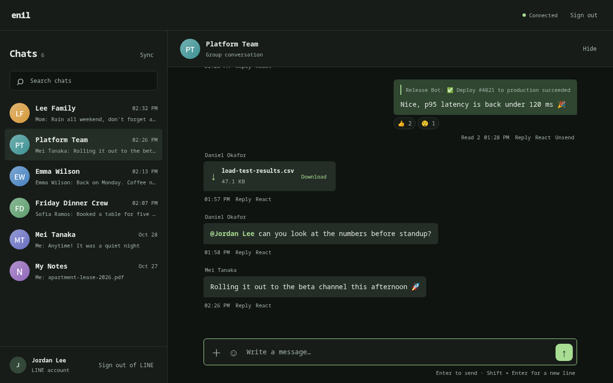

# Web page

[繁體中文](web.zh-TW.md)

The daemon can also serve LINE as a web page. One machine runs the daemon and
holds the LINE session, and any browser on your tailnet uses it. The browsers
share the daemon's one LINE login, so they add no devices to your LINE
account.



The page is off by default. It starts when `ENIL_WEB_ADDR` is set.

| Variable | Effect |
|---|---|
| `ENIL_WEB_ADDR` | `host:port` to listen on. Use the machine's Tailscale IP, for example `100.64.0.1:3440`. Do not use `0.0.0.0`: the address is the only network boundary. |
| `ENIL_WEB_KEY` | The sign-in key: 16 or more of `A-Z a-z 0-9 - . _ ~`. Without it, each start makes a new key. |

At start the daemon logs `[web] sign in: http://<addr>/?key=<key>`. Open that
link once in each browser, or open the address and type the key. The browser
then keeps a cookie for 400 days. Change the key to sign out every browser.
Signing out on one browser clears its cookie, but does not revoke a copy of
that cookie. Change the key if a cookie or the key may have been exposed.
The page uses HTTP, so its cookie does not have the `Secure` attribute. Use a
trusted Tailscale network and keep the sign-in link private.

If the address does not exist yet (Tailscale is still starting), the daemon
tries again every 10 seconds. LINE keeps working in the meantime.

## What the page can and cannot do

The page sends the same commands as the panel, over a WebSocket that the
daemon connects to its own socket. These are different from the panel:

- Files are uploaded from the browser, then sent. Uploads are kept under
  `media/web-uploads/` until the daemon answers the send, whether it succeeds
  or fails. If the answer is lost, a sweep removes uploads older than 24
  hours at startup and then hourly. Uploads share a 1 GiB storage limit; up
  to four can run at once. An upload stops after 30 seconds without data or
  one hour in total.
- The clipboard commands are refused. They read the daemon machine's
  clipboard, not the browser's. Paste an image into the page instead.
- The page can read only the media cache and the login QR. This boundary
  assumes the state directory is not being changed by an untrusted local
  process. A program running as the daemon's user can already read
  `storage.json` directly.
- Only images and MP4 open in the browser. Every other file downloads.
- Image and GIF uploads stop at 20 MB; videos and files stop at 1 GB. The page
  checks the file before uploading it.

Use **Sync** to refresh the chat list and the open conversation, or tap a
connection notice to retry. The first unread message has a divider. Search
matches chat names, senders and message previews. Tap a quote to find its
original in the loaded messages. In the image viewer, use the arrows to switch
images and the wheel, double-click, pinch or zoom buttons to change the zoom.

With the image viewer closed and focus outside an input, textarea, select or
editable element, `/` returns to the list and focuses search, and `r` syncs.
In the list, or with focus in the sidebar, up/down or `j`/`k` select a chat.
Enter opens the selected chat when focus is on a chat row or the page body.
In an open chat, those keys scroll messages when focus is outside the sidebar.
Outside inputs, Esc closes the sticker or mention picker, cancels a reply,
returns to the list, or clears search, in that order. These shortcuts require
the chat workspace and ignore Ctrl, Alt, Command and text composition. Use
up/down, `j`/`k`, `/` and `r` without Shift. Esc also closes the mention
picker from the message input.

In the message input, Enter selects an open mention choice. Otherwise, Enter
sends when the viewport is at least 701px wide and the primary pointer is
fine; in other cases it adds a line. Shift+Enter adds a line. In the image
viewer, left/right switch images, `+`/`=` and `-` zoom, Shift plus the arrow
keys pan, and Esc closes the viewer. A zoomed image can also be dragged.

## Run it on a Mac

Only one daemon may hold the same LINE session. Stop the daemon on the other
machine first (`systemctl --user disable --now enil`). The official LINE app
on another device can stay signed in.

Install Deno and FFmpeg and clone the repository, including linejs:

```sh
brew install deno ffmpeg
git clone --recurse-submodules \
  https://github.com/frankekn/omarchy-line.git "$HOME/omarchy-line"
```

Replace `100.64.0.1` below with this Mac's Tailscale IPv4 address, then run the
commands in a terminal on the Mac. They create a new random web key and fill
all four placeholders in the plist. The log directory and plist are private
because both can contain the web key.

```sh
checkout="$HOME/omarchy-line"
plist="$HOME/Library/LaunchAgents/io.github.frankekn.enil.plist"
tailscale_ip=100.64.0.1
web_key="$(openssl rand -hex 32)"
mkdir -p "$HOME/Library/LaunchAgents" "$HOME/Library/Logs/enil"
chmod 700 "$HOME/Library/Logs/enil"
cp "$checkout/daemon/enil.plist" "$plist"
chmod 600 "$plist"
plutil -replace ProgramArguments.1 \
  -string "$checkout/daemon/enil-run.sh" "$plist"
plutil -replace WorkingDirectory -string "$checkout/daemon" "$plist"
plutil -replace EnvironmentVariables.HOME -string "$HOME" "$plist"
plutil -replace EnvironmentVariables.ENIL_WEB_ADDR \
  -string "${tailscale_ip}:3440" "$plist"
plutil -replace EnvironmentVariables.ENIL_WEB_KEY -string "$web_key" "$plist"
plutil -replace StandardOutPath \
  -string "$HOME/Library/Logs/enil/enil.log" "$plist"
plutil -replace StandardErrorPath \
  -string "$HOME/Library/Logs/enil/enil.log" "$plist"
plutil -lint "$plist"
launchctl bootstrap "gui/$(id -u)" "$plist"
launchctl kickstart "gui/$(id -u)/io.github.frankekn.enil"
```

Find the `[web] sign in:` link in the log, open it on a device in the tailnet,
then use the QR to log in to LINE:

```sh
tail -f "$HOME/Library/Logs/enil/enil.log"
```

To stop the agent for this login session:

```sh
launchctl bootout "gui/$(id -u)" \
  "$HOME/Library/LaunchAgents/io.github.frankekn.enil.plist"
```

The plist loads again at the next login. To start it sooner, run the bootstrap
and kickstart commands above.

On macOS the daemon has no desktop notifications and no suspend hook. The
watchdog still rebuilds a stale push connection.
