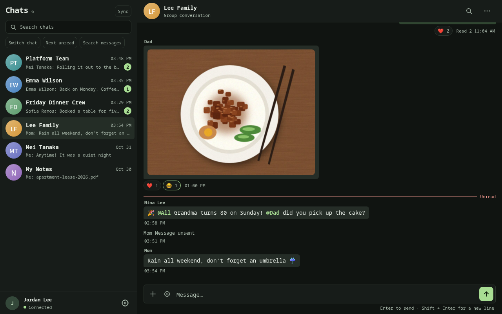

# Web page

[繁體中文](web.zh-TW.md)

The daemon can also serve LINE as a web page. One machine runs the daemon and
holds the LINE session, and any browser on your tailnet uses it. The browsers
share the daemon's one LINE login, so they add no devices to your LINE
account.



The page is off by default. It starts when `ENIL_WEB_ADDR` is set.

| Variable | Effect |
|---|---|
| `ENIL_WEB_ADDR` | `host:port` to listen on. Use the machine's Tailscale IP, for example `100.64.0.1:3440`. Do not use `0.0.0.0`: requests to the machine's actual IP will be refused. |
| `ENIL_WEB_KEY` | The sign-in key: 16 or more of `A-Z a-z 0-9 - . _ ~`. If missing or invalid, each start makes a new key. |
| `ENIL_WEB_TAILSCALE_LOGIN` | Optional exact Tailscale `LoginName`, such as `owner@example.com` or `owner@github`. Devices owned by this account can use the page without a key. Unset by default. |

With a valid `ENIL_WEB_KEY`, the daemon logs
`[web] sign in: http://100.64.0.1:3440/` at start, without showing the key.
If the daemon made a new key, the line includes a link containing that key.
In each browser, open the address and type the key. The browser then keeps a
cookie for up to 400 days. Anyone with the key or a valid
cookie and access to the address can read and send messages. Change the key
and restart the daemon to sign out every browser. Leaving the web page clears
that browser's cookie, but does not revoke a copy of it or log out of LINE.
Change the key if a cookie or the key may have been exposed. The page uses
HTTP, so its cookie does not have the `Secure` attribute. Use a trusted
Tailscale network and keep the sign-in link private.

Link sign-ins and form sign-ins have separate locks for the whole web server.
Ten wrong keys within ten minutes block that method, even with the correct
key, until one of those failures is more than ten minutes old. If links are
locked and the form is not, enter the key on the sign-in page; if only the
form is locked, a sign-in link can still work. Together the two methods allow
up to 20 wrong keys in ten minutes. Requests with a `Host` that does not match
`ENIL_WEB_ADDR` receive 421. Sign-ins with `Sec-Fetch-Site: cross-site` or
`same-site` receive 403 and do not count toward the lock. POST and WebSocket
requests with an `Origin` must match the page's origin. Requests without it
are also allowed, for non-browser clients; this check does not replace
authentication.
The server allows up to 32 WebSocket connections at once.

The browser stores drafts, reply targets, mentions and unconfirmed sends in
its local storage, and may cache media. Leaving the web page does not clear
those files. Clear the site's data and the browser cache to remove them; this
also clears its cookie. A LINE logout clears that account's drafts when the
page receives the logged-out state.

If the address does not exist yet (Tailscale is still starting), the daemon
tries again every 10 seconds. LINE keeps working in the meantime.

## Sign in automatically from your Tailscale devices

Set `ENIL_WEB_TAILSCALE_LOGIN` to your account's exact `UserProfile.LoginName`
from `tailscale whois --json <your-device-IP>`, then restart the daemon. On
macOS, the App Store CLI is
`/Applications/Tailscale.app/Contents/MacOS/Tailscale`. On Linux, `tailscale`
must be on the daemon's `PATH`. No extra service or proxy is needed; keep
opening the same `http://<Tailscale-IP>:3440/` address.

The server asks its local Tailscale daemon who owns the actual TCP peer IP.
It never accepts an account name from HTTP headers. Only native tailnet IPs
and the configured user's untagged devices qualify. Failed lookups, other
accounts and tagged devices still need the web key. Keep a fixed
`ENIL_WEB_KEY` as a fallback if the CLI is unavailable. Access is granted to
all devices owned by the configured account, so only name your own account.
Connect directly: reverse proxies and subnet routers can hide the browser's
identity, and proxy-marked requests are not automatically authenticated.

Identity decisions are cached for up to 15 seconds. Tailscale access does not
mint a persistent browser cookie. Existing WebSockets remain authorized until
they disconnect; a new HTTP request or WebSocket handshake checks identity
again using the cache. Changing the web key only revokes key-based cookies.
To disable automatic access, unset `ENIL_WEB_TAILSCALE_LOGIN` and restart the
daemon; the restart also closes existing WebSockets. “Leave web page” clears
the key-based cookie, but an allowed Tailscale device can immediately enter
again without a key.

## What the page can and cannot do

The page sends the same commands as the panel, over a WebSocket that the
daemon connects to its own socket. These are different from the panel:

- Files are uploaded from the browser, then sent. Uploads are kept under
  `media/web-uploads/`; the bridge tries to remove each after the daemon
  answers the send, whether it succeeds or fails. Leftover uploads, including
  ones never sent or whose reply was lost, are swept when they are over 24
  hours old: at startup and then hourly. They can remain longer while the
  daemon is stopped or a deletion fails. Uploads share a 1 GiB storage limit;
  up to four can run at once. An upload stops after 30 seconds without data
  or one hour in total.
- The clipboard commands are refused. They read the daemon machine's
  clipboard, not the browser's. Paste an image into the page instead.
- The WebSocket forwards only the commands the page itself sends. It refuses
  other daemon commands.
- The page can read only the media cache and the login QR. This boundary
  assumes the state directory is not being changed by an untrusted local
  process. A program running as the daemon's user can already read
  `storage.json` directly.
- The server can serve JPEG, PNG, GIF, WebP and files with an ISO-BMFF `ftyp`
  signature inline; other files download. Playback depends on the browser.
- Image and GIF uploads stop at 20 MiB; videos and files stop at 1 GiB. The
  page checks the file's contents and name before uploading it.
- The browser loads stickers and FLEX images directly from their HTTPS URLs.
  Those hosts can see the browser's IP address and the requested URL.

The sidebar heading shows the number of visible chats and contains **Sync**.
Use it to refresh the chat list and the open conversation. The LINE disconnected
and restricted notices also offer retry. Search matches chat names, senders and
message previews. To unhide a chat, search for it, open the **Hidden** result
and choose **Unhide**. A divider marks the first unread message when it can be
identified in the loaded history. Tap a quote to find its original in the
loaded messages.
In the image viewer, use the arrows to switch images and the wheel,
double-click, pinch or zoom buttons to change the zoom.

While you follow new messages at the bottom, the page can remove older loaded
messages to keep about 500 confirmed rows. Scroll up to try to load them again;
see the sparse-cache limitation below. The page keeps the loaded history while
you read above the bottom, and defers removal when it would disturb an unread
marker, a selection, focus or media. After scrolling away from the bottom,
**Jump to latest** returns to the newest loaded messages and resumes following.
New messages do not pull you away from older content.

Adjacent messages from the same author within five minutes form a visual run.
Dates, unread dividers, replies, system events, unsent messages, pending sends
and decryption errors break runs. Every message retains its time and read status. Day headings show Today
or Yesterday when applicable, with the full date in their accessible name and
hover text.

Unconfirmed sends remain visible for review and manual retry. If the outcome
is unknown, retrying can send the same message twice. Recent acknowledged
sends remain visible while the page waits for their matching echo; this
temporary cache is cleared on reload.

With the image viewer closed and focus in the chat list or message area, `/`
returns to the list and focuses search, `r` syncs, and `j`/`k` select a chat
or scroll messages. These character shortcuts do not run on other controls.
On the first workspace render, the list gets focus if the viewport is wider
than 700 px, the primary pointer is not coarse, and nothing else is focused.
Its focus ring stays hidden until the first key press. With no chat open, the
empty pane names the switcher and next-unread keys.
Clicking a blank area can move focus to the page body; the character shortcuts
then stop until you focus the list or messages again.

Outside inputs, up/down also navigate. When navigating the list, Enter opens
the selected chat if focus is on the list, a chat row or the page body. Esc
closes an open message-action menu first, then reaction pickers, even from the
message input. Outside inputs it
then closes the sticker or mention picker, cancels a reply, returns to the
list, or clears search.
Esc also closes the mention picker from the message input. These shortcuts
require the chat workspace and ignore Ctrl, Alt, Command and text composition.
Use up/down, `j`/`k`, `/` and `r` without Shift.

Ctrl+K (Command+K on a Mac) opens the chat switcher from anywhere in the
workspace, including the message input. The "Switch chat" button above the
list opens it too. Type part of a chat name: exact matches come first, then
prefix, substring and in-order letter matches. Chats with unread messages and
recent activity lead each group. Hidden chats are listed with a "Hidden" tag.
Up/down select, Enter opens and Esc closes and returns focus.

"Search messages" above the list, or Enter in the chat search box, opens
message search. It searches only messages this daemon has cached, not all of
your LINE history. Type text and press Enter. Results list the chat, the time
and a snippet with the match marked, newest first. Up/down select, Enter on
an unchanged query opens the selected message, and Esc closes and returns
focus. The chat opens like a click, so it is marked read the same way, and
older pages load until the message is in view. "Search" in the chat header
searches only the open chat; "Search all chats" widens it. Hidden chats are
left out unless searched from their own header. See
[Search](protocol.md#search) for what can be matched.

"Next unread" above the list appears when a visible chat has unread messages.
It opens the next unread chat below the current one in list order and wraps
to the top. Alt+Down does the same outside text fields, and `]` does it when
focus is on the chat list or the messages. Opening a chat this way marks it
read like a click.

The tab title shows the unread total of visible chats, for example
`(3) Line Web`, capped at `99+`. The favicon gets a dot while there is unread
mail. The title adds "Offline" after the connection drops and "Sign-in
required" when the web session needs a key.

In the message input, Enter selects an open mention choice. Otherwise, Enter
sends when the viewport is at least 701px wide and the primary pointer is
fine; in other cases it adds a line. Shift+Enter adds a line. In the image
viewer, left/right switch images, `+`/`=` and `-` zoom, Shift plus the arrow
keys pan, and Esc closes the viewer. A zoomed image can also be dragged.

If a reconnect detects that the web cookie has expired, reconnecting stops
and a notice offers a sign-in link. The page and composer stay in place so you
can copy a draft before signing in. Drafts already saved in browser storage
remain available after sign-in.

After a dropped connection, the page retries after 1 s, and doubles the wait
up to 15 s. When the network comes back or the tab becomes visible, it
reconnects at once, one time per outage. The page's HTML, CSS and JavaScript
are sent with Brotli or gzip when the browser accepts it. Media from
`/api/file` is already compressed and is sent as is.

### Settings

The page has no top bar. The gear button at the bottom left, next to your
name and the connection status, opens a dialog with four options. The status
is a dot and a word, in the warning color while the page is disconnected. On
a phone the button is at the bottom of the chat list; an open chat shows only
its own header. On the LINE sign-in screen the button and the status sit in
the bottom-left corner. Each browser keeps its own settings in local storage;
the server does not store them.

- **Interface text** scales controls, menus, settings, sender names, times and
  status. Choose 85%, 100%, 115%, 130% or 150%, where 100% is 14 px.
- **Reading text** independently scales chat names, message bubbles and the
  message input, with the same five sizes and a 14 px default. Sidebar previews
  and quotes scale with it while staying smaller than chat names. On phones,
  the input stays at least 16 px to prevent zoom when you focus it. Previously
  saved **Message text** sizes continue to apply.
- **Theme** is **Match system** by default, which uses the green light or dark
  colors from the system setting. The other themes take their colors from
  Omarchy themes: Catppuccin, Catppuccin Latte, Everforest, Flexoki Light,
  Gruvbox, Kanagawa, Matte Black, Nord, Rosé Pine and Tokyo Night. Some text
  colors are adjusted so that all text meets WCAG AA contrast.
- **New message sound** is off by default. When it is on, the page plays a
  short tone for a new message from someone else. It does not play for your
  own messages, hidden chats, or the chat that you are viewing while the
  window has focus. One chat plays at most one tone every 2 seconds.

Changes apply immediately. Both text sizes are saved in this browser and
apply before the first frame on reload. If you previously saved one text size,
that size becomes the starting value for both controls. Esc or the close
button closes the dialog and returns focus to **Settings**.

### Pinned and muted chats

Open **Chat options** (the three-dot button) in the chat header to reach
**Pin**, **Mute** and **Hide**. Press Escape to close it and return focus to
the button. Pin and Mute turn each preference on or off for the open chat.
The daemon keeps them in `pinned.json` and `muted.json` in its
state directory, so every device that opens the page sees the same pinned and
muted chats.

- Pinned chats stay at the top of the list, sorted among themselves by recent
  activity, with a small pin mark. The quick switcher puts them first in each
  match group, and "Next unread" follows the same order.
- A muted chat stays in the list. Its unread count shows in a dimmer badge
  next to a muted-bell mark, and the chat does not move to the unread group.
  It plays no new message sound, does not count in the tab title, and "Next
  unread" skips it. The daemon also sends no desktop notification for it.
- Screen readers hear "Pinned" or "Muted" as part of the chat row name.

The panel (QML plugin) does not show pinned or muted chats yet. A muted chat
still gets no desktop notification when you use only the panel.

### Daemon status

Below the settings, a read-only **Status** block shows what the daemon
reports in `state.json` when the dialog opens. It does not update while the
dialog stays open:

- **LINE sign-in**: signed in (with your LINE name), signed out, signing in,
  or failed.
- **Push connection**: connected or disconnected since a time, or paused by a
  LINE restriction with its code.
- **Last sync**: the last time the chat list was fresh.
- **Sync failures in a row**, with the reason when there is one.
- **State updated**: the last time the daemon wrote its state.

Times from today show only the clock. Older times add the date, and the year
when it is not the current year.

A row whose field the daemon does not write is left out. `state.json` has no
daemon version or commit, so the block does not show one. It has no restart
or other actions.

### Account

The **Account** section at the bottom of the dialog has two buttons, each
with a short explanation:

- **Leave web page** signs this browser out. LINE stays signed in.
- **Sign out of LINE** asks for confirmation, then signs the daemon out of
  LINE. The panel and every browser need a new QR code sign-in. It shows
  only while LINE is signed in.

### Data use

On the first connection the page gets no old events, only the latest event
number. On a reconnect it gets only the events after the last one it
applied, or the whole recent list after a daemon restart. See
[protocol.md](protocol.md#incremental-event-catch-up). The chat list preview
is at most 200 characters, so list search matches only that part of a long
last message.

### Message actions, voice and location

Messages with available commands show one **Message actions** button beside
the bubble. With a mouse,
hover over the message to reveal it; keyboard focus also reveals it. On touch
screens it stays visible with a 44px target. The menu uses text labels, supports
arrow keys, Home, End and Escape, and stays inside the viewport. Moving the
message by scrolling closes the menu without jumping the reading position.

Choose **Reply** or **React** in the menu. React focuses the first choice and
keeps the choices above the composer; selecting or cancelling returns focus to
Message actions. When an update removes those actions, focus returns to the
message area. The menu can also offer:

- **Copy** copies the text of a text, FLEX or other message with text. On a
  secure origin (HTTPS or `localhost`), the page uses the browser clipboard
  API. A plain HTTP address, such as a Tailscale IP, has no clipboard API, so
  the page selects the text in a hidden field and copies it with the browser's
  copy command. If the browser refuses both, a dialog shows the text already
  selected so that you can copy it by hand. "Copied" appears briefly on
  success.
- **Save** downloads an image, video, file or voice message through
  `/api/file`, with the same session cookie and host checks as other media.
  The file gets its LINE file name; without one it gets a name such as
  `line-image-<id>.png`, where the extension comes from the file's contents.
  The image viewer also has **Download original**.
- **Forward** is on text messages only. It opens a chat picker with the same
  ranking as the chat switcher, asks for confirmation, and sends the same text
  to the chosen chat as a new message. Hidden chats are not listed. Media
  cannot be forwarded yet.

A voice message shows its length from LINE's `AUDLEN` metadata and a **Play
voice message** button. The button downloads the clip through the normal
download and E2EE decryption path and replaces itself with the browser's audio
player. When LINE did not send a length, it appears after the player reads the
clip. The page plays the clip from a `blob:` URL, so the player does not need
range requests.

A location message shows the place's title, its address and an **Open in
Maps** link to `https://www.google.com/maps?q=<lat>,<lng>`. The link opens in
a new tab without a referrer. The page does not embed a map or load map
images.

## Known limitations

- The page reaches the daemon only through the exact address in
  `ENIL_WEB_ADDR`. Open it by that IP address, not by a MagicDNS or other
  host name; requests for any other host name are refused.
- Do not run any other HTTP service on the same IP address. Browsers do not
  separate cookies by port, so a page served from another port on that address
  can read and send the enil sign-in cookie. Here, "read" means that the other
  service receives it in HTTP requests. The cookie is `HttpOnly`, so page
  scripts cannot read it through `document.cookie`.
- A sign-in link with `?key=` stays in the browser history. Prefer typing the
  key on the sign-in page. Open a sign-in link directly, from the address bar
  or a terminal. Links opened from another site are refused when the browser
  sends `Sec-Fetch-Site: cross-site` or `same-site`. Browsers may omit this
  header on plain HTTP, including Tailscale IP addresses; in that case the
  sign-in can succeed and wrong keys count toward the link lock. Do not rely on
  this check to block links from other sites. The form has a separate lock.
- The HTTP cookie has no `Secure` attribute. Browser notifications normally
  require HTTPS or another secure context, and this page does not implement
  browser notifications. The daemon's desktop notifications are separate.
- Each ten-failure sign-in lock applies to all browsers of that web server.
  A correct key cannot use the locked method until its failures age out.
- Cookies cannot be revoked one at a time. Change the key and restart the
  daemon to invalidate all of them.
- Media from `/api/file` may stay in the browser cache for up to 24 hours.
  Changing the web key signs every browser out, but it does not remove media
  a browser has already cached. Login QR responses have the same cache
  lifetime. An expired copy can remain in browser storage until it is
  evicted or the cache is cleared.
- A cached first history page can show an older version of an edited message
  while the LINE history response is delayed. Revalidation can also fail.
- Files cannot be sent to multi-person rooms whose chat ID starts with `r`.
- Browser find, including Ctrl+F, searches only currently loaded messages.
- If the daemon's local message cache has gaps, messages removed from the
  page's window may not load again when you scroll up. This can happen if the
  daemon stops before pending cache writes are flushed.
- A signed-in browser can send WebSocket frames of up to about 64 MiB, which
  the server buffers in memory before its 1 MiB check refuses them.

## Run it on a Mac

Only one daemon may hold the same LINE session. Stop the daemon on the other
machine first (`systemctl --user disable --now enil`). The official LINE app
on another device can stay signed in.

Install Deno and FFmpeg and clone the repository, including linejs:

```sh
brew install deno ffmpeg
git clone --recurse-submodules \
  https://github.com/frankekn/omarchy-line.git "$HOME/omarchy-line"
```

If the checkout already exists, update it and skip the clone. If an older
agent is loaded, stop it with the `launchctl bootout` command below before
replacing its plist. The commands below generate a new key, so existing web
browsers must sign in again.

Replace `100.64.0.1` below with this Mac's Tailscale IPv4 address, then run the
commands in a terminal on the Mac. They create a new random web key and fill
all four placeholders in the plist. The log directory and plist are private
because both can contain the web key. The plist requests a soft and hard
`NumberOfFiles` limit of 8192.

```sh
checkout="$HOME/omarchy-line"
plist="$HOME/Library/LaunchAgents/io.github.frankekn.enil.plist"
tailscale_ip=100.64.0.1
web_key="$(openssl rand -hex 32)"
mkdir -p "$HOME/Library/LaunchAgents" "$HOME/Library/Logs/enil"
chmod 700 "$HOME/Library/Logs/enil"
cp "$checkout/daemon/enil.plist" "$plist"
chmod 600 "$plist"
plutil -remove ProgramArguments.1 "$plist"
plutil -insert ProgramArguments.1 \
  -string "$checkout/daemon/enil-run.sh" "$plist"
plutil -replace WorkingDirectory -string "$checkout/daemon" "$plist"
plutil -replace EnvironmentVariables.HOME -string "$HOME" "$plist"
plutil -replace EnvironmentVariables.ENIL_WEB_ADDR \
  -string "${tailscale_ip}:3440" "$plist"
plutil -replace EnvironmentVariables.ENIL_WEB_KEY -string "$web_key" "$plist"
plutil -replace StandardOutPath \
  -string "$HOME/Library/Logs/enil/enil.log" "$plist"
plutil -replace StandardErrorPath \
  -string "$HOME/Library/Logs/enil/enil.log" "$plist"
plutil -lint "$plist"
launchctl bootstrap "gui/$(id -u)" "$plist"
launchctl kickstart "gui/$(id -u)/io.github.frankekn.enil"
```

The log does not show this key. Print it in the same terminal with
`echo "$web_key"`, or read it from the plist with
`plutil -extract EnvironmentVariables.ENIL_WEB_KEY raw "$plist"`. On a device
in the tailnet, open `http://<Tailscale-IP>:3440/` and type the key, then use
the QR to log in to LINE:

```sh
tail -f "$HOME/Library/Logs/enil/enil.log"
```

To stop the agent for this login session:

```sh
launchctl bootout "gui/$(id -u)" \
  "$HOME/Library/LaunchAgents/io.github.frankekn.enil.plist"
```

The plist loads again at the next login. To start it sooner, run the bootstrap
and kickstart commands above.

The Linux systemd unit sets `LimitNOFILE=8192`. After updating the installed
plugin, run its `daemon/install.sh` to install the updated unit and restart
the service. If descriptors run out, the daemon stays up and its listeners
retry; they can accept connections again once descriptors are available.

The launchd setup has no native macOS notification or suspend integration.
The daemon listens for suspend through logind only on Linux, and
notifications need `notify-send`. On macOS, the watchdog still rebuilds a
stale push connection.
