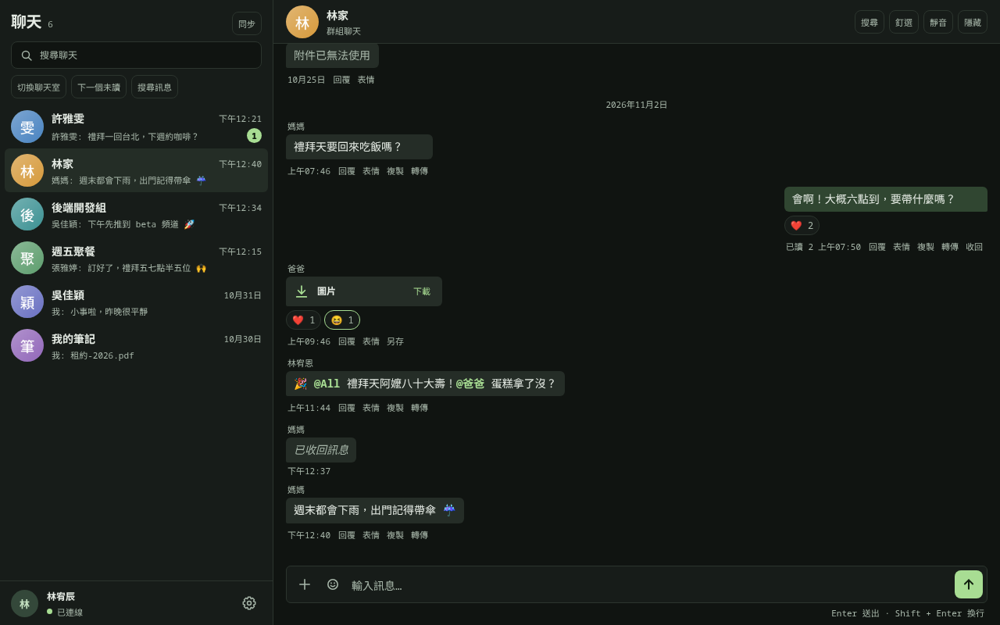

# 網頁版

[English](web.md)

daemon 也可以用網頁提供 LINE。一台機器執行 daemon、持有 LINE session，tailnet
裡的任何瀏覽器都可以使用它。這些瀏覽器共用 daemon 的那一個 LINE 登入，不會在你的
LINE 帳號裡多出裝置。



網頁版預設關閉，設定 `ENIL_WEB_ADDR` 才會啟動。

| 變數 | 作用 |
|---|---|
| `ENIL_WEB_ADDR` | 要監聽的 `host:port`。請用這台機器的 Tailscale IP，例如 `100.64.0.1:3440`。不要用 `0.0.0.0`：對機器實際 IP 的請求會被拒絕。 |
| `ENIL_WEB_KEY` | 登入用的 key：16 個以上的 `A-Z a-z 0-9 - . _ ~`。沒設定或格式不對時，每次啟動都會產生新的 key。 |

設定有效的 `ENIL_WEB_KEY` 時，daemon 啟動會記錄
`[web] sign in: http://100.64.0.1:3440/`，不會顯示 key。daemon 自行產生新 key 時，
這行會包含帶有該 key 的連結。在每個瀏覽器開啟位址後，輸入 key。之後瀏覽器最多保留
cookie 400 天。
能連到位址且持有 key 或有效 cookie 的人都能讀取和傳送訊息。換掉 key 並重啟
daemon，會讓所有瀏覽器登出。「離開網頁」只清除該瀏覽器的 cookie，不會撤銷已複製的
cookie，也不會登出 LINE。如果 cookie 或 key 可能外洩，請更換 key。網頁使用
HTTP，因此 cookie 沒有 `Secure` 屬性。請使用可信任的 Tailscale 網路，並保護登入
連結。

連結登入和表單登入各有獨立的鎖定，適用於整個 web server。任一方式在十分鐘內收到
十次錯誤 key，就會暫時阻止該方式登入，正確 key 也受阻，直到其中一次錯誤超過十分鐘。
若只有連結被鎖定，請在登入頁面輸入 key；若只有表單被鎖定，仍可使用登入連結。
兩種方式合計最多允許十分鐘內輸入 20 次錯誤 key。
`Host` 與 `ENIL_WEB_ADDR` 不符的請求會回 421。帶有
`Sec-Fetch-Site: cross-site` 或 `same-site` 的登入請求會回 403，且不計入鎖定次數。
帶有 `Origin` 的 POST 和 WebSocket 請求必須與網頁同源；沒有 `Origin` 的請求也會允許，以支援非
瀏覽器 client。這項檢查不取代身分驗證。伺服器最多同時接受 32 條 WebSocket 連線。

瀏覽器的 local storage 會存草稿、回覆目標、mention 和未確認的傳送，也可能快取媒體。
「離開網頁」不會清除這些資料。要刪除它們，請清除瀏覽器的網站資料與快取；這也會清除
cookie。網頁收到 LINE 登出狀態時，會清除該帳號的草稿。

如果位址還不存在（Tailscale 還在啟動），daemon 每 10 秒重試一次，LINE 本身照常運作。

## 網頁版能做和不能做的事

網頁送出的指令和 panel 相同，透過 WebSocket 轉到 daemon 自己的 socket。和 panel
不同的地方：

- 檔案要先從瀏覽器上傳，再傳送。上傳的檔案放在 `media/web-uploads/`；daemon 回覆
  傳送結果後，bridge 會嘗試刪除，不論成功或失敗。殘留的上傳檔（包括未送出或回覆
  遺失的檔案）超過 24 小時後，會在啟動時或之後每小時的清掃中刪除；daemon 停止或
  刪除失敗時可能留得更久。上傳檔共用 1 GiB 儲存上限，最多同時進行四個上傳。上傳
  連續 30 秒沒有資料，或總時間超過一小時，就會停止。
- 剪貼簿指令一律拒絕，因為它們讀的是 daemon 那台機器的剪貼簿，不是瀏覽器的。
  要傳圖片，請直接貼到網頁裡。
- WebSocket 只轉送網頁本身會送出的指令，其他 daemon 指令一律拒絕。
- 網頁只能讀 media 快取和登入 QR。這個邊界假設 state 目錄沒有被不可信任的本機程式
  更動。以 daemon 使用者身分執行的程式本來就能直接讀取 `storage.json`。
- 伺服器可直接顯示 JPEG、PNG、GIF、WebP 和有 ISO-BMFF `ftyp` 標記的檔案；其他
  檔案會下載。能否播放取決於瀏覽器。
- 圖片和 GIF 上限為 20 MiB，影片和檔案上限為 1 GiB；網頁會在上傳前檢查內容和檔名。
- 瀏覽器直接從 HTTPS 網址載入貼圖和 FLEX 圖片。那些主機看得到瀏覽器的 IP 位址與
  請求的網址。

側欄標題列顯示目前可見的聊天數，並提供「同步」，可更新聊天清單和目前的聊天室。
LINE 連線中斷與帳號受限提示也提供重試。搜尋會比對聊天名稱、發話者和訊息預覽。
要取消隱藏，請搜尋並開啟標示「已隱藏」的結果，再按「取消隱藏」。已載入的歷史中若能
辨識第一則未讀訊息，就會在它前面顯示分隔線。點引言可跳到已載入的原訊息。圖片檢視器
可用箭頭切換圖片，並用滾輪、雙擊、雙指或按鈕縮放。

停在底部跟著新訊息時，頁面可能移除較舊的已載入訊息，保留約 500 則已確認訊息；
往上捲可以嘗試再次載入，請留意下方的稀疏快取限制。往上閱讀時會保留已載入的歷史；
若移除會影響未讀分隔線、選取、焦點或媒體，頁面會延後移除。

未確認的傳送會保留，讓你查看或手動重試。如果結果未知，重試可能會送出兩次。最近已
確認的傳送會留在畫面上等待對應的 echo；重新載入頁面會清除這份暫存。

圖片檢視器關閉、焦點在聊天清單或訊息區時，`/` 會回到清單並聚焦搜尋框，`r`
會同步，`j`／`k` 可以選擇聊天或捲動訊息。這些單字元快捷鍵在其他控制項上不會
作用。工作區首次顯示時，若 viewport 寬於 700 px、主要指標不是 coarse，且沒有其他
焦點，就會聚焦聊天清單。點擊空白處可能讓焦點回到頁面 body；這些快捷鍵會停止，直到
重新聚焦清單或訊息區。

焦點不在輸入欄時，也可用上下鍵導航；在清單導航時，焦點在清單、聊天列或頁面 body，
Enter 可開啟選中的聊天。Esc 會先關閉 reaction 選單，訊息輸入框也適用。焦點不在輸入欄時，
之後會依序關閉貼圖或 mention 選單、取消回覆、回到清單或清空搜尋。訊息輸入框內的
Esc 也可以關閉 mention 選單。這些快捷鍵只在聊天工作區開啟時作用，並忽略 Ctrl、
Alt、Command 及輸入法組字；上下鍵、`j`／`k`、`/` 和 `r` 不要搭配 Shift。

Ctrl+K（Mac 上是 Command+K）可以在工作區任何位置開啟「切換聊天室」，包括訊息
輸入框。清單上方的「切換聊天室」按鈕也可以開啟。輸入聊天室名稱的一部分：完全符合
排最前，接著是前綴、子字串和依序字元符合。同一級中，有未讀和最近活動的聊天室排在
前面。已隱藏的聊天室也會列出，並標示「已隱藏」。上下鍵選擇，Enter 開啟，Esc 關閉
並讓焦點回到原處。

清單上方的「搜尋訊息」，或在聊天搜尋框按 Enter，會開啟訊息搜尋。它只搜尋這台
daemon 已快取的訊息，不是整個 LINE 歷史。輸入文字後按 Enter，結果依新到舊列出
聊天室、時間和標出命中處的片段。上下鍵選擇；查詢沒改時按 Enter 開啟選到的訊息；
Esc 關閉並讓焦點回到原處。開啟的方式和點擊聊天室相同，已讀行為也一樣，並會往前
載入舊訊息直到那則訊息出現。聊天室標頭的「搜尋」只搜尋目前的聊天室，「搜尋全部
聊天室」可以放寬範圍。已隱藏的聊天室不列入，除非從它自己的標頭搜尋。哪些訊息
比對得到見[搜尋](protocol.zh-TW.md#搜尋)。

有未讀的聊天室時，清單上方會顯示「下一個未讀」。它會依清單順序開啟目前聊天室之後
的下一個未讀聊天室，到底後從頭開始。焦點不在文字欄位時，Alt+下鍵也有相同作用；
焦點在聊天清單或訊息區時，可以按 `]`。用這種方式開啟的聊天，已讀行為和點擊相同。

分頁標題會顯示未隱藏聊天室的未讀總數，例如 `(3) Line Web`，超過 99 顯示 `99+`。
有未讀時 favicon 會加一個小圓點。連線中斷時標題會加上「離線」，網頁 session
需要重新輸入 key 時會加上「需要登入」。

訊息輸入框有 mention 選項時，Enter 會選擇該選項。否則只有在 viewport 寬至少
701px 且主要指標精細時，Enter 才會送出；其他情況會換行。Shift+Enter 換行。
圖片檢視器用左右鍵切換圖片、`+`／`=` 和 `-` 縮放、Shift 加方向鍵平移，Esc 關閉。
放大的圖片也可以拖曳。

重連時若發現網頁 cookie 已失效，會停止重連並顯示提示及登入連結。頁面和輸入框會
保留，你可以先複製草稿再登入。已存入瀏覽器儲存空間的草稿，重新登入後仍可使用。

連線中斷後，網頁會在 1 秒後重試，之後每次等待時間加倍，最多 15 秒。網路恢復或分頁
變成可見時，會立刻重連，每次中斷只會提前一次。瀏覽器支援時，網頁的 HTML、CSS 和
JavaScript 會用 Brotli 或 gzip 壓縮傳送。`/api/file` 的媒體本身已經壓縮，會照原樣
傳送。

### 設定

網頁沒有頂端標題列。左下角你的名稱和連線狀態旁邊的齒輪按鈕「設定」會開啟設定
面板，有三個選項。連線狀態是一個圓點加文字，中斷時改用警示色。手機上按鈕在聊天
清單底部；開啟聊天室時只顯示該聊天室自己的標頭。LINE 登入畫面的按鈕和連線狀態
在左下角。設定存在每個瀏覽器的 local storage，不會存到伺服器。

- **字體大小**：整個頁面一起縮放，可選 85%、100%、115%、130% 或 150%；100% 是
  14 px。
- **主題配色**：預設是「跟隨系統」，依系統設定使用綠色的明亮或深色配色。其他主題
  的顏色取自 Omarchy 主題：Catppuccin、Catppuccin Latte、Everforest、Flexoki
  Light、Gruvbox、Kanagawa、Matte Black、Nord、Rosé Pine 和 Tokyo Night。部分文字
  顏色經過調整，讓所有文字都符合 WCAG AA 對比。
- **新訊息提示音**：預設關閉。開啟後，收到別人的新訊息會播放一個短音效。自己傳的
  訊息、已隱藏的聊天室，以及視窗在前景時正在看的聊天室都不會播放。同一個聊天室
  2 秒內最多播放一次。

變更會立即套用。按 Esc 或關閉按鈕會關閉面板，焦點回到「設定」。

### 釘選和靜音

聊天室標題列的「釘選」和「靜音」可以開關目前聊天室的這兩個設定。daemon 把它們存在
state 目錄的 `pinned.json` 和 `muted.json`，所以每個開啟網頁的裝置看到的釘選和靜音
都一樣。

- 釘選的聊天室固定排在清單最上面，彼此之間依最近活動排序，並有一個小的圖釘標記。
  快速切換會把它們排在每一組符合結果的最前面，「下一個未讀」也依照同樣的順序。
- 靜音的聊天室仍然留在清單中。未讀數用較淡的標記顯示，旁邊有靜音的鈴鐺標記，也不會
  移到未讀那一組。它不播放新訊息提示音、不計入分頁標題的未讀數，「下一個未讀」也會
  跳過它。daemon 也不會為它發桌面通知。
- 螢幕閱讀器會把「已釘選」或「已靜音」當成聊天室列名稱的一部分念出來。

面板（QML 外掛）目前還不會顯示釘選和靜音。不過只用面板時，daemon 一樣不會為靜音的
聊天室發桌面通知。

### daemon 狀態

設定下方有唯讀的「狀態」區塊，顯示開啟面板當下 daemon 在 `state.json` 裡回報的
資訊。面板開著時不會更新：

- **LINE 登入**：已登入（附上你的 LINE 名稱）、未登入、登入中或登入失敗。
- **推播連線**：已連線或已中斷，以及從什麼時候開始；因 LINE 限制暫停時會附上代碼。
- **上次同步**：聊天清單最後一次是最新的時間。
- **連續同步失敗**：次數，有原因時附上原因。
- **狀態更新**：daemon 最後一次寫入狀態的時間。

daemon 沒有寫的欄位就不顯示。`state.json` 沒有 daemon 版本或 commit，所以不顯示。
這個區塊沒有重啟或其他操作。

### 帳號

設定面板最下方的「帳號」區塊有兩個按鈕，各附一句說明：

- **離開網頁**：只登出這個瀏覽器，LINE 保持登入。
- **登出 LINE**：確認後讓 daemon 登出 LINE。面板和所有瀏覽器都要重新掃描 QR code
  才能使用。只在 LINE 已登入時顯示。

### 資料用量

第一次連線時，網頁不會收到舊的事件，只會收到最新的事件編號。重連時只會收到它最後
套用的事件之後的部分；daemon 重啟過時則收到整份最近事件。見
[protocol.zh-TW.md](protocol.zh-TW.md#增量補齊事件)。聊天清單的預覽最多 200 個字，
所以清單搜尋只比對長訊息的這一段。

### 訊息動作、語音和位置

訊息的「回覆」和「表情」旁邊會視情況顯示以下動作：

- **複製**：複製文字、FLEX 等有文字的訊息。在安全來源（HTTPS 或 `localhost`）
  上，網頁使用瀏覽器的剪貼簿 API。純 HTTP 位址（例如 Tailscale IP）沒有剪貼簿
  API，網頁會把文字放進隱藏欄位、選取後用瀏覽器的複製指令複製。如果兩種方式都被
  瀏覽器拒絕，會開一個對話框，文字已經選取好，可以手動複製。成功時會短暫顯示
  「已複製」。
- **另存**：透過 `/api/file` 下載圖片、影片、檔案或語音，和其他媒體一樣經過
  session cookie 和 Host 檢查。檔名使用 LINE 的檔名；沒有檔名時使用像
  `line-image-<id>.png` 的名稱，副檔名依檔案內容決定。圖片檢視器也有「下載原圖」。
- **轉傳**：只有文字訊息有。它會開啟聊天室選擇器，排序方式和「切換聊天室」相同；
  確認後把相同的文字當成新訊息送到選定的聊天室。已隱藏的聊天室不會列出。目前還
  不能轉傳媒體。

語音訊息會顯示 LINE `AUDLEN` metadata 提供的長度，以及「播放語音」按鈕。按下後，
網頁透過一般的下載和 E2EE 解密路徑取得音檔，並換成瀏覽器的音訊播放器。LINE 沒有
提供長度時，播放器讀到音檔後才會顯示長度。音檔從 `blob:` URL 播放，所以播放器不
需要 range request。

位置訊息會顯示地點名稱、地址，以及「在地圖中開啟」連結，連到
`https://www.google.com/maps?q=<lat>,<lng>`，在新分頁開啟且不帶 referrer。網頁
不嵌入地圖，也不載入地圖圖片。

## 已知限制

- 網頁只能透過 `ENIL_WEB_ADDR` 設定的位址連到 daemon。請用該 IP 開啟，不要用
  MagicDNS 或其他主機名稱；使用其他主機名稱的請求會被拒絕。
- 不要在同一個 IP 位址上執行其他 HTTP 服務。瀏覽器不按 port 區分 cookie，所以同一
  位址上其他 port 提供的網頁可以讀取並送出 enil 登入 cookie。cookie 有 `HttpOnly`
  屬性：這裡的「讀取」是指其他服務會從 HTTP 請求收到它；頁面的 script 無法透過
  `document.cookie` 直接讀取。
- 帶有 `?key=` 的登入連結會留在瀏覽器歷史紀錄。建議在登入頁面輸入 key。若使用登入
  連結，請從網址列或終端機直接開啟。瀏覽器送出 `Sec-Fetch-Site: cross-site` 或
  `same-site` 時，從其他網站開啟的連結會被拒絕。瀏覽器在一般 HTTP 上（包括
  Tailscale IP）可能不送這個標頭，此時登入可能成功，錯誤 key 會計入連結登入鎖定。
  不要依賴這項檢查阻擋其他網站的連結。表單有獨立的鎖定。
- HTTP cookie 沒有 `Secure` 屬性。瀏覽器通知通常需要 HTTPS 或其他安全來源，而這個
  網頁目前沒有實作瀏覽器通知。daemon 的桌面通知是另一項功能。
- 每個十次錯誤 key 造成的登入鎖定都適用於該 web server 的所有瀏覽器。鎖定期間，
  正確 key 也不能使用被鎖定的方式登入，直到錯誤次數過期。
- cookie 不能逐一撤銷。換 key 並重啟 daemon，會使所有 cookie 失效。
- `/api/file` 的媒體可能在瀏覽器快取保留最多 24 小時。換 web key 會讓所有瀏覽器
  登出，但不會刪除瀏覽器已快取的媒體。登入 QR 回應有相同的快取時效；過期副本仍可能
  留在瀏覽器儲存空間，直到被清除或淘汰。
- 從快取載入歷史首頁時，如果 LINE 的 history 回覆較慢，可能暫時顯示編輯前的舊內容。
  背景重新驗證也可能失敗。
- 無法向聊天室 ID 以 `r` 開頭的多人聊天室傳檔案。
- 瀏覽器的頁面搜尋（包括 Ctrl+F）只搜尋目前已載入的訊息。
- daemon 的本地訊息快取若有缺口，從頁面視窗裁掉的訊息可能無法往上載回。例如 daemon
  在待寫入的快取資料 flush 前中斷，就可能發生這個情況。
- 已登入的瀏覽器可以送出最大約 64 MiB 的 WebSocket frame，伺服器會先把整個 frame
  收進記憶體，之後 1 MiB 的檢查才會拒絕它。

## 在 Mac 上執行

同一個 LINE session 只能由一個 daemon 持有。先停掉另一台的 daemon
（`systemctl --user disable --now enil`）。另一個裝置上的官方 LINE 可以保持登入。

安裝 Deno 和 FFmpeg，並 clone repo 與 linejs：

```sh
brew install deno ffmpeg
git clone --recurse-submodules \
  https://github.com/frankekn/omarchy-line.git "$HOME/omarchy-line"
```

如果 checkout 已經存在，請先更新它並跳過 clone。若舊 agent 已載入，替換 plist 前
請先執行下方的 `launchctl bootout` 指令。下方指令會產生新的 web key，因此原有的
瀏覽器都需要重新登入。

先把下方的 `100.64.0.1` 換成這台 Mac 的 Tailscale IPv4 位址，再在 Mac 的終端機
執行這些指令。指令會產生新的隨機 web key，並填入 plist 的四個佔位值。log 目錄和
plist 都設為私人權限，因為兩者都可能包含 web key。plist 的 `NumberOfFiles` 軟、
硬限制都設為 8192。

```sh
checkout="$HOME/omarchy-line"
plist="$HOME/Library/LaunchAgents/io.github.frankekn.enil.plist"
tailscale_ip=100.64.0.1
web_key="$(openssl rand -hex 32)"
mkdir -p "$HOME/Library/LaunchAgents" "$HOME/Library/Logs/enil"
chmod 700 "$HOME/Library/Logs/enil"
cp "$checkout/daemon/enil.plist" "$plist"
chmod 600 "$plist"
plutil -remove ProgramArguments.1 "$plist"
plutil -insert ProgramArguments.1 \
  -string "$checkout/daemon/enil-run.sh" "$plist"
plutil -replace WorkingDirectory -string "$checkout/daemon" "$plist"
plutil -replace EnvironmentVariables.HOME -string "$HOME" "$plist"
plutil -replace EnvironmentVariables.ENIL_WEB_ADDR \
  -string "${tailscale_ip}:3440" "$plist"
plutil -replace EnvironmentVariables.ENIL_WEB_KEY -string "$web_key" "$plist"
plutil -replace StandardOutPath \
  -string "$HOME/Library/Logs/enil/enil.log" "$plist"
plutil -replace StandardErrorPath \
  -string "$HOME/Library/Logs/enil/enil.log" "$plist"
plutil -lint "$plist"
launchctl bootstrap "gui/$(id -u)" "$plist"
launchctl kickstart "gui/$(id -u)/io.github.frankekn.enil"
```

log 不會顯示這個 key。可在同一個終端機用 `echo "$web_key"` 印出，或用
`plutil -extract EnvironmentVariables.ENIL_WEB_KEY raw "$plist"` 從 plist 讀出。
在 tailnet 裡的裝置開啟 `http://<Tailscale-IP>:3440/` 並輸入 key，再用 QR 登入
LINE：

```sh
tail -f "$HOME/Library/Logs/enil/enil.log"
```

要在這次登入期間停止 agent：

```sh
launchctl bootout "gui/$(id -u)" \
  "$HOME/Library/LaunchAgents/io.github.frankekn.enil.plist"
```

下次登入時 plist 會再載入。要提早啟動，請執行上面的 bootstrap 和 kickstart
指令。

Linux systemd unit 設有 `LimitNOFILE=8192`。更新已安裝的 plugin 後，執行它的
`daemon/install.sh`，安裝更新過的 unit 並重啟服務。檔案描述符耗盡時 daemon 會繼續
運作，listener 會重試；描述符可用後就能再接受連線。

launchd 設定沒有 macOS 原生通知或休眠整合。daemon 只在 Linux 上透過 logind
接收休眠事件，通知則需要 `notify-send`；在 macOS 上，watchdog 仍然會重建停滯的
push 連線。
