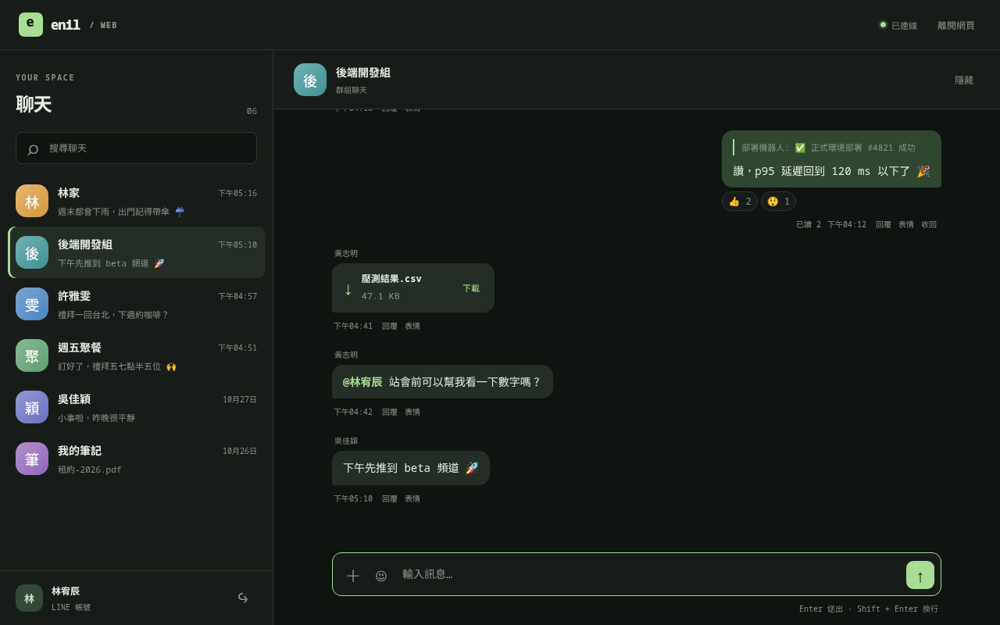

# 網頁版

[English](web.md)

daemon 也可以用網頁提供 LINE。一台機器執行 daemon、持有 LINE session，tailnet
裡的任何瀏覽器都可以使用它。這些瀏覽器共用 daemon 的那一個 LINE 登入，不會在你的
LINE 帳號裡多出裝置。



網頁版預設關閉，設定 `ENIL_WEB_ADDR` 才會啟動。

| 變數 | 作用 |
|---|---|
| `ENIL_WEB_ADDR` | 要監聽的 `host:port`。請用這台機器的 Tailscale IP，例如 `100.64.0.1:3440`。不要用 `0.0.0.0`：這個位址是唯一的網路邊界。 |
| `ENIL_WEB_KEY` | 登入用的 key：16 個以上的 `A-Z a-z 0-9 - . _ ~`。沒設定時，每次啟動都會產生新的 key。 |

daemon 啟動時會記錄 `[web] sign in: http://<addr>/?key=<key>`。每個瀏覽器開一次
這個連結，或開位址後輸入 key。之後瀏覽器會保留 cookie 400 天。換掉 key 就會讓
所有瀏覽器登出。

如果位址還不存在（Tailscale 還在啟動），daemon 每 10 秒重試一次，LINE 本身照常運作。

## 網頁版能做和不能做的事

網頁送出的指令和 panel 相同，透過 WebSocket 轉到 daemon 自己的 socket。和 panel
不同的地方：

- 檔案要先從瀏覽器上傳，再傳送。上傳的檔案放在 `media/web-uploads/`，LINE 收到後
  就刪除，最多保留一天。
- 剪貼簿指令一律拒絕，因為它們讀的是 daemon 那台機器的剪貼簿，不是瀏覽器的。
  要傳圖片，請直接貼到網頁裡。
- 網頁只能讀 media 快取和登入 QR，讀不到 `storage.json` 或其他檔案。
- 只有圖片和 MP4 會在瀏覽器裡開啟，其他檔案一律下載。

## 在 Mac 上執行

同一個 LINE session 只能由一個 daemon 持有。先停掉另一台的 daemon
（`systemctl --user disable --now enil`）。另一個裝置上的官方 LINE 可以保持登入。

安裝 Deno 和 FFmpeg，並 clone repo 與 linejs：

```sh
brew install deno ffmpeg
git clone --recurse-submodules \
  https://github.com/frankekn/omarchy-line.git "$HOME/omarchy-line"
```

先把下方的 `100.64.0.1` 換成這台 Mac 的 Tailscale IPv4 位址，再在 Mac 的終端機
執行這些指令。指令會產生新的隨機 web key，並填入 plist 的四個佔位值。log 目錄和
plist 都設為私人權限，因為兩者都可能包含 web key。

```sh
checkout="$HOME/omarchy-line"
plist="$HOME/Library/LaunchAgents/io.github.frankekn.enil.plist"
tailscale_ip=100.64.0.1
web_key="$(openssl rand -hex 32)"
mkdir -p "$HOME/Library/LaunchAgents" "$HOME/Library/Logs/enil"
chmod 700 "$HOME/Library/Logs/enil"
cp "$checkout/daemon/enil.plist" "$plist"
chmod 600 "$plist"
plutil -replace ProgramArguments.1 \
  -string "$checkout/daemon/enil-run.sh" "$plist"
plutil -replace WorkingDirectory -string "$checkout/daemon" "$plist"
plutil -replace EnvironmentVariables.HOME -string "$HOME" "$plist"
plutil -replace EnvironmentVariables.ENIL_WEB_ADDR \
  -string "${tailscale_ip}:3440" "$plist"
plutil -replace EnvironmentVariables.ENIL_WEB_KEY -string "$web_key" "$plist"
plutil -replace StandardOutPath \
  -string "$HOME/Library/Logs/enil/enil.log" "$plist"
plutil -replace StandardErrorPath \
  -string "$HOME/Library/Logs/enil/enil.log" "$plist"
plutil -lint "$plist"
launchctl bootstrap "gui/$(id -u)" "$plist"
launchctl kickstart "gui/$(id -u)/io.github.frankekn.enil"
```

在 log 找到 `[web] sign in:` 連結，在 tailnet 裡的裝置上開啟，再用 QR 登入 LINE：

```sh
tail -f "$HOME/Library/Logs/enil/enil.log"
```

要在這次登入期間停止 agent：

```sh
launchctl bootout "gui/$(id -u)" \
  "$HOME/Library/LaunchAgents/io.github.frankekn.enil.plist"
```

下次登入時 plist 會再載入。要提早啟動，請執行上面的 bootstrap 和 kickstart
指令。

在 macOS 上 daemon 沒有桌面通知，也沒有休眠事件。watchdog 仍然會重建停滯的
push 連線。
